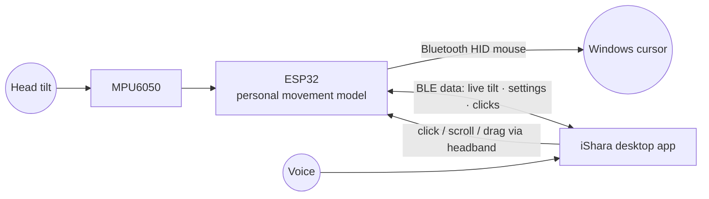

# iShara — hands-free computer control

**A head-tilt mouse headband + offline voice commands, for people who can't use their hands.**

Tilt your head to move the cursor. Say *"click"*, *"scroll down"* or *"start typing"* to act.
No hands, no internet, no account.

**Website:** https://ishara-mu-three.vercel.app · **Download:** [latest release](https://github.com/muradahmed23/ishara/releases/latest)

[](https://github.com/muradahmed23/ishara/actions/workflows/tests.yml)

---

## What it does

| | |
|---|---|
| 🎯 **Head mouse** | An ESP32 + MPU6050 headband is a real Bluetooth mouse. Head tilt moves the cursor; works with no app installed. |
| 🗣️ **Voice control** | Click, double / right / middle click, scroll, drag, back / forward, pause, on-screen keyboard: 30+ commands, fully offline (Vosk). |
| ⌨️ **Dictation** | "Start typing" turns speech into text (faster-whisper, offline). |
| 🧭 **Personal calibration** | A guided, spoken calibration learns each user's comfortable range and how the band sits on *their* head. Axes and directions are detected automatically. |
| 🔒 **Works everywhere** | Clicks are sent by the headband as *hardware* clicks, so they work even in protected windows (On-Screen Keyboard, admin apps), where software clicks are blocked. |
| 🎓 **Training** | Seven practice lessons build skill step by step. |
| 👥 **Profiles** | One profile per user: calibration, speed, voice commands. |
| 🖐️ **Hand mouse mode** | Say "hand mouse" to hand control to a normal mouse (voice clicks keep working), "head mouse" to come back. |

## How it works



The movement model runs **on the headband** for low latency. The desktop app adds voice,
calibration, training and profiles. Details: [docs/architecture.md](docs/architecture.md).

## Repository

| Folder | Contents |
|---|---|
| [`firmware/`](firmware) | ESP32 firmware (Arduino) + vendored, patched BLE mouse library |
| [`desktop/`](desktop) | Windows app (Python): voice, calibration, UI, tests |
| [`website/`](website) | Next.js website (Vercel): product, hardware ordering, guide, downloads |
| [`release/`](release) | `latest.json`: single source of truth for version, installer URL, SHA-256 (website + in-app updater) |
| [`docs/`](docs) | [architecture](docs/architecture.md) · [protocol](docs/protocol.md) · [hardware](docs/hardware.md) · [design system](docs/design-system.md) |
| [`scripts/`](scripts) | one-command setup, run, flash firmware |

## Install (users)

Download **iShara-Setup.exe** from the [website](https://ishara-mu-three.vercel.app/download) and press Install.
One offline installer (~660 MB) contains the app, its runtime and all speech models: no Python, no extra downloads.
iShara starts with a spoken welcome guide: microphone → headband → Bluetooth → training → calibration (both skippable).

## Quick start (developers)

**Requirements:** Windows 10/11, Python 3.10+, Arduino IDE 2 (or `arduino-cli`) with the ESP32 core.

```powershell
git clone https://github.com/muradahmed23/ishara.git
cd ishara

.\scripts\setup.ps1            # venv, dependencies, speech models (~200 MB), runs the tests
.\scripts\flash-firmware.ps1   # build + upload the headband firmware over USB
.\scripts\run.ps1              # start the app
```

1. Pair **Ishara Mouse** in Windows Bluetooth settings (one beep = connected).
2. In the app: **Training → Calibration**, follow the voice.
3. Say **"help"** at any time to see every command.

**No hardware?** `.\scripts\run.ps1 -Sim` runs the app with simulated head movement.

## Voice commands

| Group | Say |
|---|---|
| Mouse | click · double click · right click · middle click · scroll up / down · start drag · release · click lock · go back · go forward |
| Control | hand mouse · head mouse · pause · resume · stop control · center · find cursor · keyboard |
| Typing | start typing · stop typing |
| Microphone | mute microphone · unmute microphone |
| Help | help → say a number · more · back · close |

All phrases can be renamed in Settings.

## Build the Windows installer

```powershell
.\scripts\setup.ps1 -BestDictation     # venv + all three speech models
cd desktop
.\packaging\build.ps1                  # PyInstaller -> Inno Setup -> dist\installer\iShara-Setup-<v>.exe
```

PyInstaller bundles the app and Python runtime (one-folder build); Inno Setup adds the models, shortcuts and
an in-place upgrader that never touches user data (`%APPDATA%\Ishara`). Model files are checked against
`MODELS.sha256` on first launch. Releasing: see [release/README.md](release/README.md).

## Tests

```powershell
cd desktop
python -m pytest -q
```

CI runs the desktop tests on Windows and compiles the firmware on every push.

## Hardware

ESP32 dev board · MPU6050 · Li-Po 3.7 V 1200 mAh + USB-C charger · buzzer · headband.
Wiring and bill of materials: [docs/hardware.md](docs/hardware.md).

## Status

Working prototype. Next: enclosure, battery monitoring, compact PCB, head-*turn* tracking
(gyroscope fusion), macOS / Linux app.
