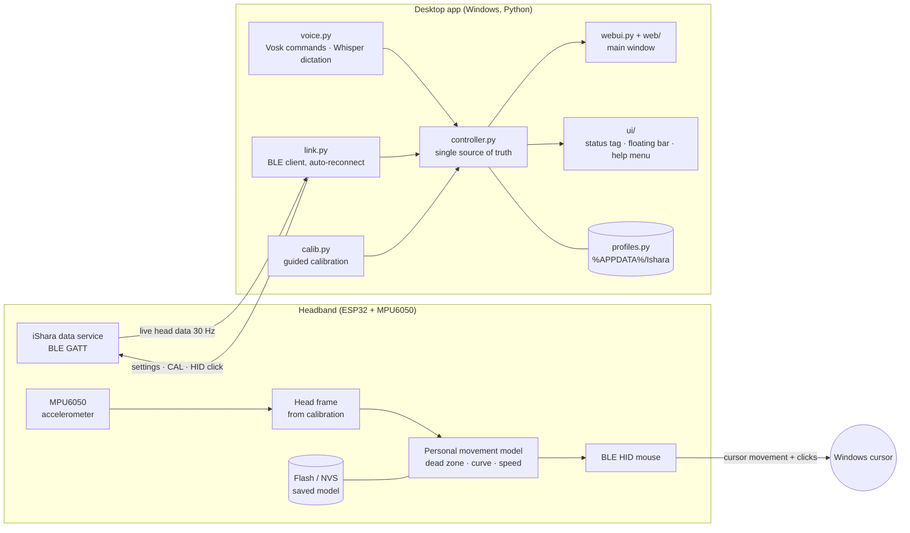

# Architecture

iShara is a **hybrid** system: the headband is a complete Bluetooth mouse on its own, and the
desktop app adds voice control, calibration, training and per-user profiles on top.



## Design decisions

| Decision | Why |
|---|---|
| **Movement runs on the headband**, not the PC | Lowest latency; the mouse works without the app, on any device that accepts a Bluetooth mouse. |
| **Clicks are sent by the headband as hardware HID clicks** (app → `HID L`) | Windows blocks *software* clicks into protected windows (On-Screen Keyboard, admin apps). Hardware clicks are never blocked. `SendInput` is only a fallback when the headband is offline. |
| **Mounting-independent tilt** (gravity frame captured at calibration) | Every user wears the band differently. The firmware measures tilt relative to the user's own neutral position, so any mounting angle works. |
| **Axes and directions learned from the user's movements** | Calibration records both axes for each movement and sets axis swap (`sw`) and direction (`ix`, `iy`) automatically, so the cursor follows the head even if the board is rotated. |
| **One controller owns all state** | Voice, dwell, help menu, UI and calibration all go through `Controller`, so pause / stop always win and the UI never disagrees with reality. |
| **Fully offline** | Speech recognition (Vosk, faster-whisper) runs locally: private, no account, no internet needed. |
| **Python mirror of the firmware model** (`model.py`) | The live indicator and calibration preview show exactly what the headband will do, and the math is unit-tested on the PC. |

## Repository layout

```
iShara/
├── firmware/
│   ├── ishara_headband/ishara_headband.ino   ESP32 firmware
│   └── libraries/ESP32-BLE-Mouse/            vendored, patched for ESP32 core 3.x
├── desktop/
│   ├── ishara_app.py                         entry point (single instance)
│   ├── ishara/
│   │   ├── protocol.py                       BLE UUIDs, packet + settings format
│   │   ├── link.py                           BLE client + hardware simulator
│   │   ├── model.py                          movement model + calibration math
│   │   ├── calib.py                          guided calibration flow (pure logic)
│   │   ├── controller.py                     actions, modes, dwell, help menu
│   │   ├── voice.py · speech.py              voice input · spoken feedback
│   │   ├── screen.py                         Windows cursor / input layer
│   │   ├── profiles.py                       per-user profiles (JSON)
│   │   ├── webui.py + web/                   main window (HTML/CSS/JS in WebView2)
│   │   └── ui/                               always-on-top overlays, practice lessons
│   ├── assets/fonts/                         Inter (bundled)
│   ├── models/                               speech models (downloaded, git-ignored)
│   └── tests/                                unit tests (pytest)
├── docs/                                     architecture, protocol, hardware, design
├── scripts/                                  setup · run · flash-firmware
└── .github/workflows/tests.yml               CI: app tests + firmware compile
```

## Runtime flow

1. **Startup:** the headband reads the sensor for 2 s and builds the user's neutral head frame.
2. **Connect:** Windows pairs with *Ishara Mouse* (HID); the app connects to the data service and pushes the profile's settings; the headband beeps once.
3. **Move:** every 15 ms the headband turns head tilt into cursor movement using the personal model.
4. **Act:** a voice command goes `voice.py → controller → link.hid()`, and the headband clicks.
5. **Calibrate:** the app streams raw tilt, guides left / right / up / down, detects axes and ranges, lets the user try it, then saves to the headband (flash) and the profile.
